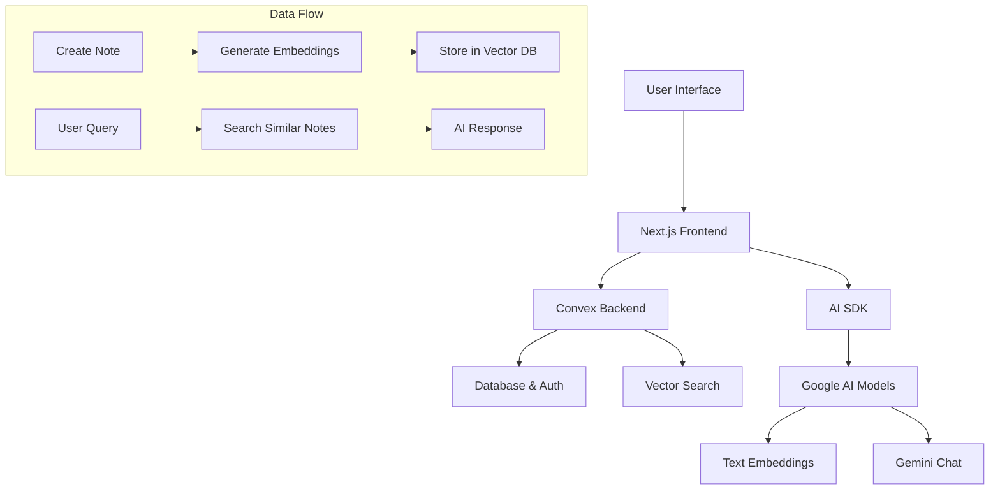

# 🤖 AskNote-AI

<div align="center">
  
  
  **A Smart Note-Taking App with AI-Powered Search & Chat**
  
  Ask questions about your notes and get instant, intelligent responses powered by AI.

  [](https://nextjs.org/)
  [](https://convex.dev/)
  [](https://sdk.vercel.ai/)
  [](https://www.typescriptlang.org/)
</div>

## ✨ Features

- 📝 **Note Management** - Create, edit, and organize your notes with a clean interface
- 🤖 **AI Chat Assistant** - Ask questions about your notes and get intelligent responses
- 🔍 **Semantic Search** - Find relevant notes using vector embeddings and similarity search
- 🔐 **Secure Authentication** - User authentication powered by Convex Auth
- 📱 **Responsive Design** - Works seamlessly on desktop and mobile devices
- 🌙 **Dark/Light Mode** - Toggle between themes for comfortable reading
- ⚡ **Real-time Updates** - Live data synchronization across devices

## 🏗️ Architecture



## 🛠️ Tech Stack

### Frontend
- **Next.js 15** - React framework with App Router
- **React 19** - Latest React with concurrent features
- **TypeScript** - Type-safe development
- **Tailwind CSS** - Utility-first styling
- **Radix UI** - Accessible component primitives
- **Lucide React** - Beautiful icons

### Backend & AI
- **Convex** - Real-time database and backend
- **AI SDK** - Unified AI interface
- **Google AI** - Gemini 2.0 Flash & Text Embeddings
- **Vector Search** - Semantic similarity matching

### Development
- **ESLint** - Code linting
- **PostCSS** - CSS processing
- **Yarn** - Package management

## 🚀 Getting Started

### Prerequisites

- Node.js 18+ installed
- Yarn package manager
- Google AI API key
- Convex account

### Installation

1. **Clone the repository**
   ```bash
   git clone https://github.com/masudursourav/AskNote-AI.git
   cd AskNote-AI
   ```

2. **Install dependencies**
   ```bash
   yarn install
   ```

3. **Set up Convex**
   ```bash
   yarn global add convex
   npx convex dev
   ```

4. **Configure environment variables**
   
   Create a `.env.local` file in the root directory:
   ```env
   # Convex (automatically set by `npx convex dev`)
   NEXT_PUBLIC_CONVEX_URL=your_convex_url
   
   # Google AI API Key
   GOOGLE_GENERATIVE_AI_API_KEY=your_google_ai_api_key
   ```

5. **Start the development server**
   ```bash
   yarn dev
   ```

6. **Open your browser**
   
   Navigate to [http://localhost:3000](http://localhost:3000)

### Database Setup

The app uses Convex with the following schema:

- **`notes`** - Stores user notes with title and body
- **`noteEmbeddings`** - Vector embeddings for semantic search
- **`users`** - User authentication data (handled by Convex Auth)

## 📖 Usage

### Creating Notes
1. Click the "Create Note" button
2. Add a title and content
3. The app automatically generates embeddings for AI search

### AI Chat
1. Click the "Ask AI" button
2. Ask questions about your notes
3. Get intelligent responses with relevant note links

### Examples of AI Queries
- "What did I write about machine learning?"
- "Find notes about my vacation plans"
- "Summarize my meeting notes from last week"

## 🔧 Configuration

### Google AI Setup
1. Get an API key from [Google AI Studio](https://makersuite.google.com/app/apikey)
2. Add it to your environment variables
3. The app uses `text-embedding-004` for embeddings and `gemini-2.0-flash` for chat

### Convex Configuration
The Convex schema supports:
- User authentication
- Note storage with user isolation
- Vector search with 768-dimensional embeddings
- Real-time data synchronization

## 📁 Project Structure

```
├── src/
│   ├── app/                    # Next.js app router
│   │   ├── (auth)/            # Authentication pages
│   │   ├── (main)/            # Main application
│   │   └── globals.css        # Global styles
│   ├── components/            # Reusable UI components
│   ├── lib/                   # Utility functions
│   └── assets/                # Static assets
├── convex/                    # Backend functions
│   ├── auth.ts               # Authentication logic
│   ├── notes.ts              # Note queries/mutations
│   ├── notesActions.ts       # Note actions with AI
│   ├── http.ts               # HTTP routes for AI chat
│   └── schema.ts             # Database schema
└── package.json              # Dependencies and scripts
```

## 🚀 Deployment

### Deploy on Vercel
1. Push your code to GitHub
2. Connect your repository to [Vercel](https://vercel.com)
3. Add environment variables in Vercel dashboard
4. Deploy automatically on push

### Deploy Convex
```bash
npx convex deploy
```

## 🤝 Contributing

1. Fork the repository
2. Create a feature branch (`git checkout -b feature/AmazingFeature`)
3. Commit your changes (`git commit -m 'Add some AmazingFeature'`)
4. Push to the branch (`git push origin feature/AmazingFeature`)
5. Open a Pull Request

## 📄 License

This project is licensed under the MIT License - see the [LICENSE](LICENSE) file for details.

## 🙏 Acknowledgments

- [Convex](https://convex.dev/) for the amazing backend platform
- [Vercel AI SDK](https://sdk.vercel.ai/) for AI integration
- [Google AI](https://ai.google.dev/) for powerful language models
- [Radix UI](https://www.radix-ui.com/) for accessible components

## 📞 Support

If you have any questions or issues, please [open an issue](https://github.com/masudursourav/AskNote-AI/issues) on GitHub.

---

<div align="center">
  Made with ❤️ by <a href="https://github.com/masudursourav">Masudur Sourav</a>
</div>
